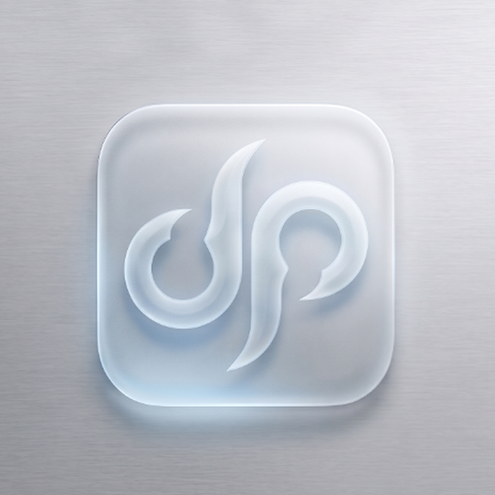

# 🛡️ Droid Prefect — Official Releases & Downloads

  

<h1 align="center">Droid Prefect</h1>

  <strong>🔒 The Hardened, Autonomous, Zero Data-Theft AI Agent for Android</strong>

  
  
  

---

## ⬇️ Download Droid Prefect

Get the latest production release of Droid Prefect directly to your Android device:

  

| Package | Version | Build | Size | SHA-256 Integrity Hash |
| :--- | :--- | :--- | :--- | :--- |
| `DroidPrefect.apk` | **v1.0.8** | `9` | `55.2 MB` | `fa527e8be72f8205f192686302dbc29a1af8c8f2cefbcaeda30c2d96b467db15` |

*All previous builds are available on the [GitHub Releases Archive](https://github.com/damodp3-stack/Droid-Prefect-Releases/releases).*

---

## 🚀 What's New in v1.0.8

- **⚡ 4 New Mobile Open-Source On-Device AI Models:**
  - `Qwen 2.5 1.5B Instruct` (High reasoning, fast inference)
  - `DeepSeek R1 Distill Qwen 1.5B` (Advanced reasoning & step-by-step thinking)
  - `SmolLM2 360M Instruct` (Ultra-lightweight ~373MB for low RAM devices)
  - `SmolLM2 1.7B Instruct` (High quality general chat)
  - *All 4 models are public and require **zero** Hugging Face tokens — download and chat completely offline!*
- **🛠️ Crash Fix:** Resolved Android 14+ `SecurityException` during screen state broadcast receiver registration in Accessibility Service.
- **🛡️ Android 13+ Restricted Settings Guide:** Added step-by-step guidance dialog when enabling Accessibility and SMS on sideloaded installations.
- **💬 Enhanced Chat Diagnostics:** When on-device AI model is not downloaded or cloud API key is missing, Droid Prefect displays clear action instructions in chat instead of failing silently.
- **🎯 Default Offline Model:** Switched default offline model to ultra-fast `Qwen 2.5 0.5B`.

---

## 📲 How to Install & Configure

1. **Download:** Tap the download button above or grab `DroidPrefect.apk` from the latest release.
2. **Open APK:** Once downloaded, tap the notification or open the APK from your browser / Files app.
3. **Allow Installation:** If prompted by Android (*"For your security, your phone is not allowed to install unknown apps from this source"*):
   - Tap **Settings** in the popup.
   - Toggle **"Allow from this source"** ON.
   - Tap **Back** and select **Install**.
4. **Android 13/14/15 Restricted Settings (Crucial for Sideloaded APKs):**
   - If Android greys out Accessibility or SMS with *"Restricted setting"*:
   - Open your phone's **Settings > Apps > Droid Prefect**.
   - Tap the **3 dots (⋮)** in the top-right corner.
   - Select **"Allow restricted settings"** and confirm with your PIN or fingerprint.
   - Return to Droid Prefect and enable **Accessibility**.
5. **Launch & Automate:** Open **Droid Prefect**, choose between 100% offline On-Device AI or your preferred cloud LLM, and start automating your device!

---

## 🔄 Built-In Over-The-Air (OTA) Updates

Droid Prefect features an **automatic in-app update engine**:
- Whenever a new version is released, the app will automatically notify you with an **Update Available** popup.
- You can download and install new updates directly from **Settings > About > Check for Updates** without needing to manually revisit this repository.
- Every update is verified via **SHA-256 checksum** before installation to guarantee authenticity and security.

---

## 🛡️ Privacy & Security Architecture

- **Zero Cloud Leaks:** Your chat memories, habits, and knowledge graphs stay encrypted on your device.
- **Hardware Encryption:** Sensitive API keys are protected using Android Keystore (AES-256-GCM) with hardware TEE/StrongBox.
- **Zero ADB Extraction:** `allowBackup="false"` prevents USB extraction and cloud data exfiltration.
- **Strict HTTPS / TLS 1.3:** Enforced network security config blocking cleartext transmissions.

---

## 💬 Support & Issue Reporting

For questions, feature suggestions, or bug reports, please open an issue in the [Releases Issues Tracker](https://github.com/damodp3-stack/Droid-Prefect-Releases/issues).
